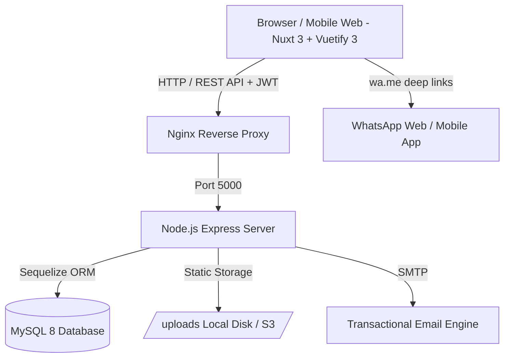

# DocClear Management System
## Product Requirements Document (PRD)
**Version:** 2.4.0  
**Status:** Active Production / Living Specification  
**Target Market:** United Arab Emirates (UAE) Corporate Services, PRO Typing Centers, Document Clearing & Business Setup Agencies  
**Stack:** Nuxt 3 · Vue 3 · Vuetify 3 · Node.js · Express · Sequelize ORM · MySQL 8  

---

## 1. Document Overview & Executive Summary

### 1.1 Executive Summary
**DocClear** (also recognized as **DocuClear**) is a modern, cloud-native enterprise resource planning (ERP) and workflow automation platform engineered specifically for the UAE document clearing, PRO services, business setup, and corporate services industry.

Traditional typing centers and document clearance firms in the UAE rely on fragmented spreadsheets, generic accounting software, and manual phone follow-ups to track thousands of recurring government renewals (Trade Licenses, Emirates IDs, Resident Visas, Labour Cards, and Medical Fitness certificates). This operational model causes missed deadlines, hefty government fines for clients, revenue leakage, and inefficient multi-bank reconciliation.

DocClear resolves these inefficiencies by combining:
1. **Automated Expiry & Compliance Monitoring**: A proactive tracking engine with multi-status Kanban and Calendar views, automated email alerts, and one-click WhatsApp client reminders.
2. **End-to-End Service Order Workflow**: Unified tracking from initial quotation to government fee typing, PRO clearance, auto-invoicing, and completion.
3. **Triple-Entry Treasury & Wallet Engine**: Strict ledger-backed tracking of cash drawers, corporate bank accounts, and client advance deposit balances.
4. **Dedicated Staff Salary & Payroll Management**: Automatic calendar-basis daily rate computations (28–31 days), unpaid leave deductions, and single or batch disbursements from cash or bank accounts.
5. **Multi-Tenant SaaS Foundation**: Complete tenant isolation, subscription plans, trial enforcement, and self-hosted licensing controls.

---

## 2. User Personas & Access Control (RBAC)

The system enforces granular Role-Based Access Control (RBAC) stored in the database with permission matrices for `read`, `write`, and `delete` across every application module.

| Role | Target Persona | Primary Responsibilities & Permissions |
|---|---|---|
| **System Developer / Super Admin** | Platform Owner / SaaS Provider | Global tenant provisioning, database migrations, subscription plans, system-wide config, developer sandbox. |
| **Business Owner / Tenant Admin** | Agency Owner / Managing Director | Full access to tenant finances, company settings, user permissions, shareholder equity, reports, and audit logs. |
| **Accountant / Finance Officer** | In-house Accountant | Invoices, expenses, bank/cash wallets, staff salary booking and disbursements, VAT reports, supplier payables. |
| **PRO / Senior Typist** | Document Clearance Officer | Customer records, document expiry tracking, service orders execution, customer document uploads, WhatsApp reminders. |
| **Field Staff / Driver** | Runner / Courier | Staff record without portal login (`is_portal_user = false`). Eligible for monthly salary payroll without system credentials. |
| **Customer Portal User** | Corporate Client / Sponsor | Read-only view of their linked company documents, active service orders, invoice status, and download receipts. |

---

## 3. Technology Stack & System Architecture



### 3.1 Architectural Stack

| Layer | Technology | Purpose & Implementation Details |
|---|---|---|
| **Frontend Framework** | Nuxt 3 (Vue 3 Composition API) | Hybrid SPA/SSR, file-based routing, auto-imports, Pinia stores. |
| **UI Component Library** | Vuetify 3 + Material Design Icons | Responsive data tables, dialogs, drawers, cards, form validation. |
| **Backend API** | Node.js (v18+) + Express.js | Modular controller-service-route architecture, rate-limiting, Helmet security. |
| **Data Persistence** | MySQL 8 + Sequelize ORM | Relational schema, foreign keys, transactions (`sequelize.transaction`), migrations. |
| **State Management** | Pinia | Global reactive state for Auth, Customers, Documents, Invoices, Wallet, Salaries. |
| **Authentication** | JWT + HTTP-Only Cookies + bcrypt | Stateless secure sessions, refresh token rotation, password hashing. |
| **Document Generation** | PDFKit | Server-side pixel-perfect PDF rendering for Invoices, Receipts, and Reports. |
| **Messaging** | Deep-link WA protocol (`wa.me`) | Instant zero-cost customer communication without third-party API lock-in. |

---

## 4. Detailed Functional Modules

### 4.1 CRM & Client Portfolio Management (`/customers`)
* **Company & Individual Profiles**: Distinguishes between corporate clients (with Trade License No.) and individual sponsors.
* **Customer 360° Dashboard**: Unified tabbed profile displaying:
  * Company details, contact person, WhatsApp number, city, and billing address.
  * Active documents and expiration status.
  * Service orders in progress and historical work.
  * Invoices, statement of account, total billed, paid, and outstanding balances.
  * Associated staff and company members.
* **Multi-Company Filtering**: Support for corporate group sponsors overseeing multiple commercial trade licenses.
* **Fuzzy Search & Soft Deletion**: Rapid typeahead lookup with soft archiving to preserve accounting trails.

### 4.2 PRO Document Tracking & Expiry Engine (`/documents`)
* **Document Types**: Native support for UAE Residency Visas, Passports, Trade Licenses, Emirates IDs, Medical Fitness, Labour Cards, Tenancy Contracts (Ejari), and custom tenant-defined types.
* **Smart Expiry Categorization**:
  * `Normal`: Expiry > 60 days.
  * `Due Soon`: Expiry within 30–60 days.
  * `Critical`: Expiry within 30 days.
  * `Expired`: Past expiry date.
* **Multi-View Interfaces**:
  * **Table View**: Sortable, filterable by customer, document type, and urgency.
  * **Kanban Board**: Drag-and-drop workflow across expiry urgency stages.
  * **Calendar View**: Visual monthly and weekly distribution of expiring files.
* **Instant Action Tools**:
  * 1-Click WhatsApp reminder pre-filled with expiry date and renewal instructions.
  * Automated email notification with branded HTML templates.
  * Attachment viewer for multi-page PDF/image copies.

### 4.3 Service Catalog & Workflow Execution (`/services`)
* **Standardized Service Master**: Pre-configured services (e.g., "New Employment Visa", "Trade License Renewal", "Investor Visa Stamping").
* **Fee Structure Segregation**:
  * **Government Fee**: Typing & immigration disbursement fees (pass-through cost).
  * **Typing / Service Fee**: Gross service revenue.
  * **PRO Charges**: Runner or express processing cost.
* **Service Orders Workflow**: Status progression: `Draft` $\rightarrow$ `Pending` $\rightarrow$ `In Progress` $\rightarrow$ `Completed` $\rightarrow$ `Cancelled`.
* **Auto-Invoicing Linkage**: Completing a service order can instantly generate an itemized invoice.

### 4.4 Sales Orders & Quotations (`/sales-orders`)
* Full quotation and order generation engine with custom line items, tax rates, and discount overrides.
* Status tracking (`Draft`, `Sent`, `Approved`, `Processing`, `Delivered`, `Cancelled`).
* Visual attachment manager supporting file uploads and previewing directly within the workspace.

### 4.5 Invoicing, UAE VAT & Billing (`/invoices`)
* **UAE Tax Compliance**: 5% standard VAT calculation, zero-rated options, exempt transactions, and TRN (Tax Registration Number) display.
* **Lifecycle**: `Draft` $\rightarrow$ `Sent` $\rightarrow$ `Partially Paid` $\rightarrow$ `Paid` $\rightarrow$ `Overdue` $\rightarrow$ `Cancelled`.
* **Automated Payments Integration**: Paying an invoice automatically creates a credit transaction in the selected Cash or Bank account and updates customer balance.
* **Print & Export Engine**: High-fidelity PDF generation with company header, QR code verification, terms, and bank transfer details.
* **Voucher Designer**: Configurable layout, custom colors, and audit trail for receipt voucher issuance.

### 4.6 Operational Expenses (OpEx) (`/expenses`)
* Dual-tab structure cleanly isolating standard operational expenditures from staff payroll.
* Two-tier expense taxonomy: Parent **Expense Types** (e.g., Office Rent, Government Portal Charges, Utilities) and granular **Sub-Types**.
* Direct disbursement tracking via selected Bank or Cash Wallet accounts.
* Receipt and tax invoice attachment uploads.

### 4.7 Dedicated Staff Salary & Payroll Management (`/expenses?tab=salary`)
* **Monthly Accrual Booking**: Accrues monthly salary liabilities on the final calendar day of the month (e.g., `30/11/2026`).
* **Dynamic Calendar Basis**: Automatically detects days in month (28, 29, 30, or 31 days) to compute precise daily wages:
  $$\text{Per-Day Rate} = \frac{\text{Monthly Base Salary}}{\text{Days in Month}}$$
* **Unpaid Leave Deduction Engine**:
  * Default: "No Leave" (0 days).
  * Calculates deduction: $\text{Leave Deduction} = \text{Leave Days} \times \text{Daily Rate}$.
  * Computes final payable amount: $\text{Net Salary} = \text{Base Salary} - \text{Leave Deduction}$.
* **Full-Width Expanded Booking Dialog**: Roomy viewport-wide (98vw) interface with full-screen toggle, preventing any text clipping and allowing rapid payroll reviews.
* **Flexible Salary Disbursements**:
  * **Individual Full / Partial Payment**: Disburse full or partial amounts to an individual employee from any Bank or Cash Wallet.
  * **Batch Multi-Select Transfer**: Multi-select staff members or "Select All" to execute bulk disbursements in a single unified operation.
* **Employee Slip Breakdown**: Detailed breakdown of basic salary, housing/HR allowance, transport, other allowances, and unpaid leave deductions.
* **Unbook Protection**: Reversible booking before disbursement, with integrity locks preventing unbooking once disbursements are executed.

### 4.8 Treasury & Triple-Entry Wallet Management (`/wallet`)
* **Account Types**: Physical Cash Drawers, Corporate Bank Accounts (WIO, ENBD, ADCB, Mashreq, etc.), and Petty Cash.
* **Ledger as Source of Truth**: Balances are dynamically calculated by summing ledger movements (`WalletTransaction`) rather than mutating a static counter, ensuring total auditability.
* **Transfer Dialog**: Double-entry transfers between internal accounts with reference tracking and currency exchange validation.
* **Statement Reconciliation**: Date-range filtering, transaction categorization, and Excel/CSV exporting.

### 4.9 Corporate Governance & Equity Management (`/management`)
* Shareholder registry with equity percentage holdings.
* Capital injection and withdrawal records.
* Formal Dividend Declaration and automated distribution computations per shareholder.
* Direct disbursement of dividends via designated company treasury accounts.

### 4.10 Leads & Sales Pipeline CRM (`/leads`)
* Inbound inquiry management categorized by source (Walk-in, Referral, Google, Social Media).
* Pipeline stages (`New`, `Contacted`, `Qualified`, `Proposal Sent`, `Won`, `Lost`).
* 1-Click conversion of a "Won" lead into a permanent Customer record.

### 4.11 PRO Tools & Utilities (`/tools`)
* **UAE Visa Overstay Fine Calculator**: Built-in rules engine calculating exact immigration fines based on residency visa category, grace period, and overstay days.
* **Typing Center CV Builder**: Structured resume generator for typing center clients seeking local employment.

### 4.12 Multi-Tenant SaaS Engine (`/saas-portal`)
* Multi-tenant architecture using column-based `tenant_id` isolation.
* Plan tiers with feature gating and user limits.
* Promo code engine supporting percentage discounts, fixed fee reductions, and expiry limits.
* Automatic subscription trial expiration and license key validation middleware.

---

## 5. Database Schema & Key Entities

```
+---------------------------------------------------------------------------------+
|                                 CORE ERD SUMMARY                                |
+---------------------------------------------------------------------------------+

 [Tenant] (1) <---+ (N) [User] (1) <---------- (N) [SalaryItem]
                  |      |                             |
                  |      +---> [Role]                  +---> [SalaryPayroll]
                  |                                    |
                  +---+ (N) [Customer]                 +---> (N) [SalaryPayment]
                  |          |
                  |          +---> (N) [Document]
                  |          +---> (N) [ServiceOrder] ---> (N) [Invoice]
                  |                                             |
                  +---+ (N) [Supplier]                          +---> (N) [InvoiceItem]
                  |
                  +---+ (N) [WalletAccount] (1) <--- (N) [WalletTransaction]
                  |                                           ^
                  +---+ (N) [Expense]                         |
                  |           +-------------------------------+
                  +---+ (N) [Shareholder]
```

### 5.1 Primary Models

| Model Name | Table Name | Purpose | Key Attributes |
|---|---|---|---|
| `User` | `users` | System users & staff | `id`, `name`, `email`, `role_id`, `is_portal_user`, `base_salary`, `tenant_id` |
| `Customer` | `customers` | Client database | `id`, `name`, `phone_whatsapp`, `trade_license_no`, `city`, `tenant_id` |
| `Document` | `documents` | Tracked customer docs | `id`, `customer_id`, `document_type_id`, `doc_number`, `expiry_date`, `status` |
| `ServiceOrder` | `service_orders` | Execution workflows | `id`, `customer_id`, `service_type_id`, `status`, `assigned_to`, `govt_fee` |
| `Invoice` | `invoices` | Billing & accounts | `id`, `invoice_number`, `customer_id`, `subtotal`, `tax`, `total`, `status` |
| `Expense` | `expenses` | Operating costs | `id`, `description`, `expense_type_id`, `amount`, `status`, `account_id` |
| `SalaryPayroll` | `salary_payrolls` | Monthly payroll run | `id`, `month`, `year`, `total_base_amount`, `total_net_amount`, `status` |
| `SalaryItem` | `salary_items` | Staff monthly line | `id`, `payroll_id`, `user_id`, `base_salary`, `leave_days`, `net_salary`, `status` |
| `SalaryPayment` | `salary_payments`| Pay disburse record | `id`, `salary_item_id`, `account_id`, `amount`, `payment_method`, `payment_date` |
| `WalletAccount` | `wallet_accounts`| Bank & cash ledgers | `id`, `name`, `account_type`, `balance`, `currency`, `tenant_id` |
| `WalletTransaction` | `wallet_transactions` | Ledger journal | `id`, `from_account_id`, `to_account_id`, `amount`, `type`, `reference_id` |
| `Shareholder` | `shareholders` | Company owners | `id`, `name`, `shares_count`, `ownership_percentage`, `tenant_id` |
| `Lead` | `leads` | Inbound pipeline | `id`, `name`, `phone`, `status`, `source`, `expected_value`, `tenant_id` |

---

## 6. Business Logic & Calculation Rules

### 6.1 UAE Value Added Tax (VAT) Formula
$$\text{Tax Amount} = \text{Taxable Subtotal} \times \frac{\text{Tax Rate (5\%)}}{100}$$
$$\text{Invoice Total} = (\text{Subtotal} - \text{Discount}) + \text{Tax Amount}$$

### 6.2 Calendar-Based Unpaid Leave Deduction Rule
1. Calculate calendar days in target payroll month:
   $$\text{Days} = \text{new Date}(YYYY, MM, 0).\text{getDate}() \quad (\text{e.g., Nov } \rightarrow 30, \text{ Oct } \rightarrow 31, \text{ Feb } \rightarrow 28/29)$$
2. Compute accurate daily rate:
   $$\text{Daily Rate} = \frac{\text{Base Monthly Salary}}{\text{Days}}$$
3. Deduct unpaid leaves:
   $$\text{Leave Deduction} = \text{Leave Days} \times \text{Daily Rate}$$
4. Final payable net salary:
   $$\text{Net Salary} = \max(0, \text{Base Monthly Salary} - \text{Leave Deduction})$$

### 6.3 Real-Time Wallet Balance Integrity Rule
Balances are strictly calculated as:
$$\text{Current Balance} = \sum (\text{Credits / Inflows}) - \sum (\text{Debits / Outflows})$$
All balance-altering operations (customer invoice receipt, expense payment, supplier settlement, salary disbursement, inter-account transfer) execute inside an atomic Sequelize SQL transaction.

---

## 7. Non-Functional Requirements (NFR)

1. **Security & Protection**:
   * Password hashing via `bcryptjs` with salt round $\ge 10$.
   * Strict CORS allowlist with credential protection.
   * Rate limiting: Global 1,000 req/15min, Authentication 100 req/hour.
   * Helmet HTTP header fortification against XSS and clickjacking.
2. **Performance & Responsiveness**:
   * Page load speeds under 1.5 seconds over 4G connections.
   * Paginated queries with indexing on `tenant_id`, `customer_id`, `expiry_date`, and `status`.
   * Gzip/Brotli compression enabled across all API responses.
3. **Auditability & Traceability**:
   * Immutable logging of financial disbursements and dividend payments.
   * Soft-deletion for sensitive records (Customers, Documents, Accounts).
4. **Availability & Resilience**:
   * System health-check endpoint at `/health`.
   * Automated database recovery scripts and database backup scripts (`backup.sh`).

---

## 8. Deployment & Environment Setup

* **Production Reverse Proxy**: Nginx handling SSL termination (Let's Encrypt), forwarding `/api/v1` to Node (port 5000) and frontend routes to Nuxt (port 3000).
* **Database Engine**: MySQL 8.0+ running with InnoDB engine and `utf8mb4` character set.
* **Process Management**: Managed via PM2 or systemd daemons for zero-downtime reloads.
* **Environment Variables**: Managed via `.env` files with strict separation of secrets between staging and production.

---

*This document was compiled directly from the active DocClear codebase and reflects all implemented modules, database models, and operational workflows.*
